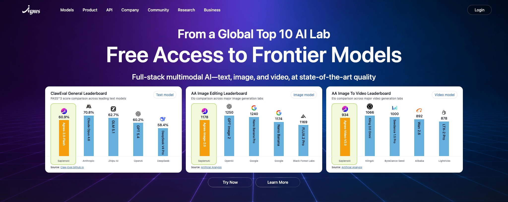

# Agnes AI 免费文本 / 生图 / 生视频 Agent Skill

[](./LICENSE)
[](./SKILL.md)
[](https://wiki.agnes-ai.com/llms.txt)
[](https://platform.agnes-ai.com/)
[](./README.md)

> **本副本说明。** 该 Skill 由 **agnes-toolkit** 仓库维护
> （`skill/agnes-ai-skill/`），是项目内的权威副本；通过 `npm run install-local`
> 与 `cli/` 中的补丁版 CLI 一起安装。当前模型与 Video 2.5 行为以本目录
> `SKILL.md` 为准（文档快照：2026-10-21，https://wiki.agnes-ai.com/llms.txt）。

Agnes AI Skill 是面向 Codex、Claude Code、OpenClaw、Claude Desktop、Hermes、
WorkBuddy、Cherry Studio、Opencode 等 AI Agent 工具的免费全模态 Skill。它通过一个根目录
`SKILL.md` 帮助 Agent 调用 Agnes 2.5/3.0 API，支持文本生成、生图、图片编辑、文生视频、图生视频和
API 集成。

适合搜索 Agnes AI skill、Codex skills、Claude Code skills、OpenClaw skills、
免费 AI API、免费 AI 模型、免费生图、免费生视频、文生图和图生视频的 Agent 工作流。

English: Agnes AI free text, image, and video generation Agent Skill for Codex,
Claude Code, OpenClaw, Claude Desktop, Hermes, WorkBuddy, Cherry Studio,
Opencode, and other SKILL.md-compatible agent tools.

## 快速开始

在 agnes-toolkit 仓库内（推荐，使用本目录的 1.3.0 更新版）：

```bash
npm run install-local   # 构建并 link 补丁版 CLI，同时安装本 Skill
agnes models            # 查看当前模型目录
agnes auth check        # 校验 AGNES_API_KEY（不会打印 key）
```

独立安装上游旧版（不推荐；上游 `SKILL.md` 仍是 1.2.2 的旧模型）：

```bash
npx skills add jomeswang/agnes-ai-skill -g
```

或直接把下面这句话复制给 Agent：

```text
请读取并安装 Agnes AI Skill：https://github.com/jomeswang/agnes-ai-skill
```

安装完成后，前往 [platform.agnes-ai.com/settings/apiKeys](https://platform.agnes-ai.com/settings/apiKeys) 注册并创建 Agnes API Key，再配置为 `AGNES_API_KEY`。之后告诉 Agent `我要生图`、`我要生视频`、`帮我改图` 或 `我要接入 Agnes API`，Agent 就可以自动选择合适的 Agnes 模型和执行方式。

这个 Skill 会帮助 Agent：

- 完成 Agnes AI 接入并持久化 `AGNES_API_KEY`
- 使用 `agnes-2.5-flash`（默认）或 `agnes-3.0-flash` 进行聊天、编码、流式输出和工具调用
- 使用 `agnes-image-2.5-flash` 进行 AI 生图、图片编辑和多图合成
- 使用 `agnes-video-2.5` / `agnes-video-2.5-flash` 进行文生视频、关键帧、图片参考和异步轮询
- 优先使用补丁版 `agnes-ai-cli` 执行真实请求

兼容工具：Codex、Claude Code、Claude Desktop、OpenClaw、Hermes、WorkBuddy、
Cherry Studio、Opencode、Kimi Work，以及其他 Agent Skills / SKILL.md 兼容环境。



## 重要公告

**当前模型与价格请以官方文档为准（本 Skill 依据 2026-10-21 文档更新）。**

- 文本默认 `agnes-2.5-flash`（可选 `agnes-3.0-flash` / `agnes-2.5-pro` / `agnes-2.5-pro-beta`）
- 图片默认 `agnes-image-2.5-flash`（可选 `agnes-image-2.1-flash` / `agnes-image-2.0-flash`）
- 视频默认 `agnes-video-2.5`（可选 `agnes-video-2.5-flash`；`agnes-video-v2.0` 已于 2026-09-25 下线）
- 当前部分模型处于限时免费推广，价格和额度可能变化

**官方平台：** https://platform.agnes-ai.com

> 涉及成本、额度或商业使用时，请以 https://wiki.agnes-ai.com/en/docs/pricing
> 和 https://wiki.agnes-ai.com/en/docs/tokenplan 的实时内容为准。

这个仓库提供一个根目录 `SKILL.md`，让编码 Agent 可以快速：

- 获取并持久化 Agnes API Key
- 使用 `agnes-2.5-flash`（默认）或 `agnes-3.0-flash` 进行聊天、编码、流式输出和工具调用
- 使用 `agnes-image-2.5-flash` 进行图像生成和编辑
- 使用 `agnes-video-2.5` / `agnes-video-2.5-flash` 进行异步视频生成和轮询

它适合 Agnes 最容易上手的使用场景：

- 一个平台同时覆盖文本、图像和视频
- 公共免费试用定位降低实验门槛
- Agent、创意生成和原型开发等高频调用工作流

这个 Skill 会保持轻量：它教 Agent 如何成功调用 Agnes API，而不是把完整官方文档复制到仓库里。

## 安装

使用支持仓库 Skill 的安装器：

```bash
npx skills add jomeswang/agnes-ai-skill -g
```

这个仓库只有一个根目录 `SKILL.md`，支持仓库根目录 Skill 的安装器可以直接发现它。

已验证的安装路径：

```bash
npx skills add jomeswang/agnes-ai-skill --list
npx skills add jomeswang/agnes-ai-skill --agent codex --yes
```

仓库会被识别为一个名为 `agnes-ai-skill` 的根目录 Skill。

## 配套 CLI

推荐使用 agnes-toolkit 仓库内的补丁版 CLI（`cli/`，基于上游
`jomeswang/agnes-ai-cli` v0.1.6，版本号 `0.2.0-local.1`）：

```bash
npm run install-local   # 构建并 link 补丁版 CLI，同时安装本 Skill
agnes models            # 查看当前模型目录
agnes auth check        # 校验 AGNES_API_KEY（不会打印 key）
```

仅作为兜底：`npx -y agnes-ai-cli@^0.1.0` 是旧的 0.1.6 上游版本，
不支持 Video 2.5，图片默认模型也更旧。

## 模型指南（2026-10-21 文档）

默认选择：

- `agnes-2.5-flash`（默认）
  - 聊天、编码、流式输出、工具调用、图片理解和 Agent 工作流
  - `text chat` 未传 `--model` 时的默认模型
- `agnes-3.0-flash`
  - 新一代文本模型，适合更重的 Agent 编码 / 工具编排任务
- `agnes-2.5-pro` / `agnes-2.5-pro-beta`
  - 付费推理模型（1M 上下文），适合高难度编码、科学推理和长上下文生产任务
- `agnes-image-2.5-flash`（默认）
  - 文本生图、图生图、多图合成的默认选择
  - size 使用 `1K/2K/3K/4K` 档位并配合 `ratio`；精确尺寸会被归一化
- `agnes-image-2.1-flash` / `agnes-image-2.0-flash`
  - 仅在明确需要兼容旧行为时使用；Image 2.0 不支持 `ratio`，也不要传 `tags`
- `agnes-video-2.5`（默认）
  - 文生视频、关键帧、图片/音频/视频参考，720P–2K
- `agnes-video-2.5-flash`
  - 仅 720P、最多 5 张参考图、不支持参考视频；当前限时免费
- `agnes-video-v2.0` 已于 2026-09-25 下线，禁止用于新任务
- `agnes-3.0-pro` 仍为 coming soon，暂不可调用

## 为什么选择 Agnes

Agnes 最有价值的场景，是一个工作流需要同时用到三层能力：

- 文本：规划、编码、提示词和 Agent 循环
- 图像：营销、电商和创意视觉生成
- 视频：分镜、产品演示、运动测试和短视频内容

公开材料反复强调 Agnes 适合：

- 快速 AI 产品原型
- 高频 Agent 工作流
- 前端或 HTML 生成
- 营销和电商素材
- 广告、分镜和电影感短视频迭代

这个 Skill 把这些能力整理成一个可复用安装目标，帮助 Codex 和其他兼容 `SKILL.md` 的 Agent 选择正确模型并完成鉴权。

## 它做什么

- Agnes 快速开始文档中的平台和鉴权流程
- Agnes 平台设置页里的 API Key 创建路径
- 面向未来会话的 `AGNES_API_KEY` 持久化设置
- 文本和图像端点的 OpenAI 风格请求模式
- Video 2.5 的异步任务流程（创建任务 → 用 video_id + model_name 轮询）
- 从公开材料提炼的实用场景

## 手动安装

如果你的工具不支持仓库安装器，可以手动复制 `SKILL.md` 到对应目录，例如：

```bash
mkdir -p ~/.codex/skills/agnes-ai-skill
cp SKILL.md ~/.codex/skills/agnes-ai-skill/SKILL.md
```

然后在新会话中让 Agent 使用 `agnes-ai-skill`。
